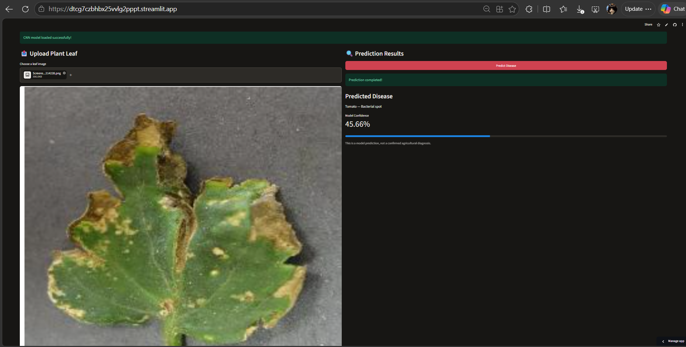
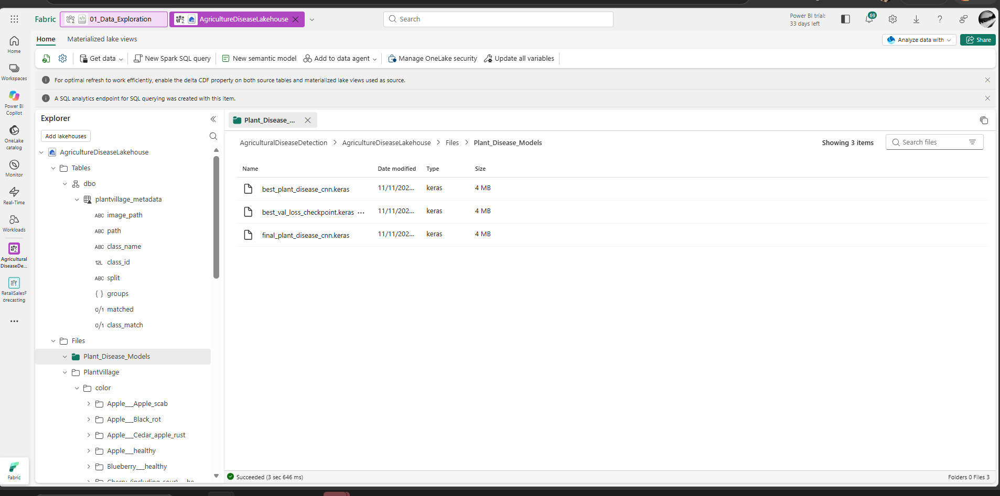
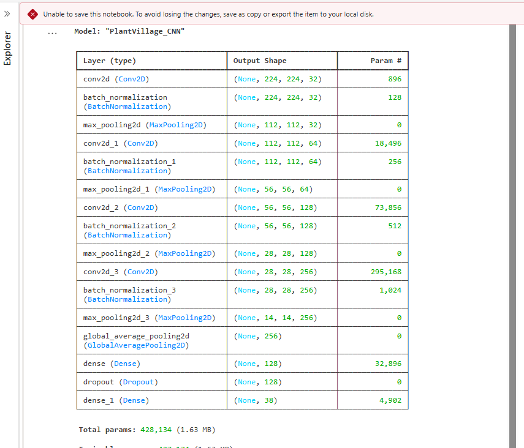
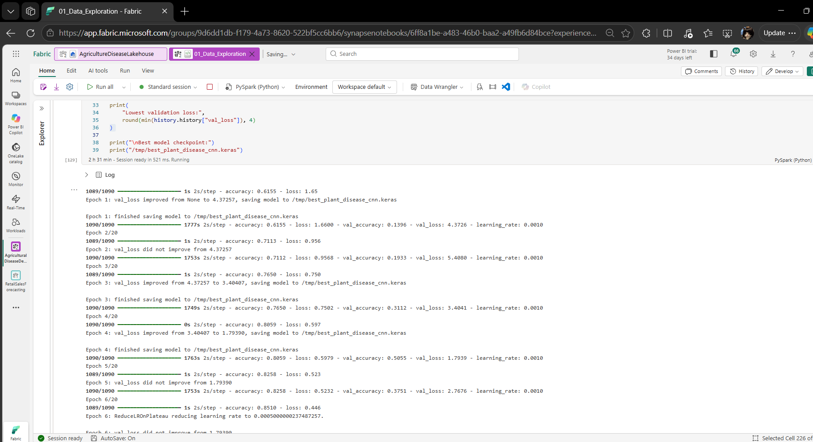
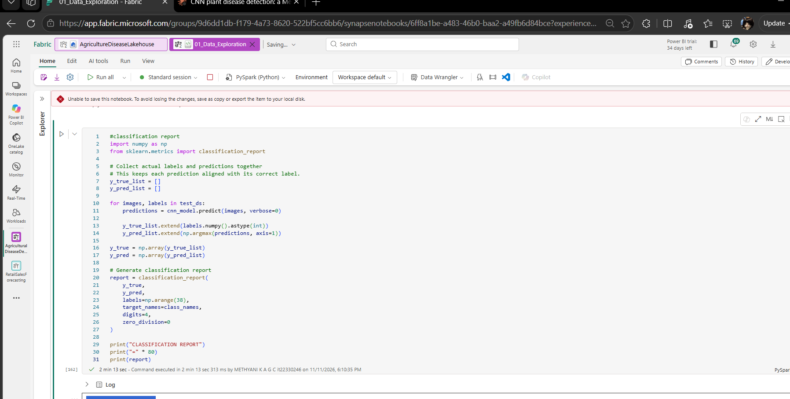
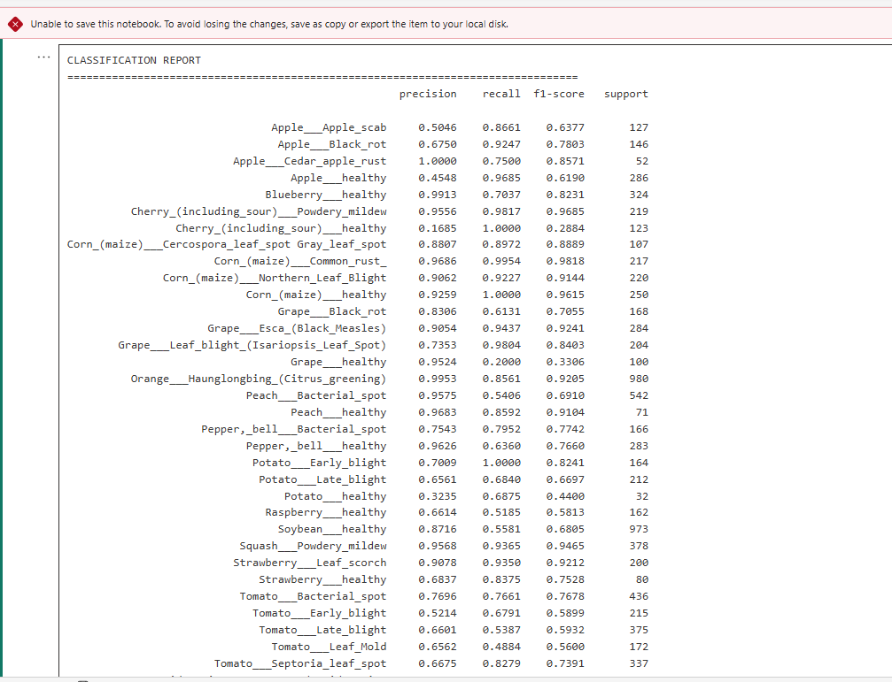
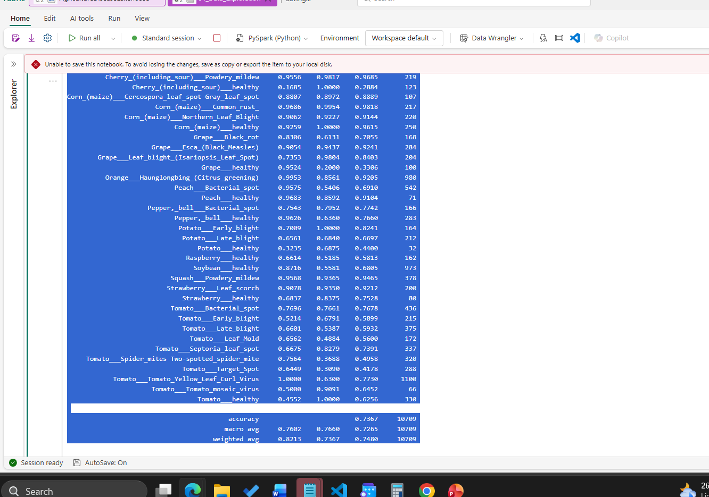
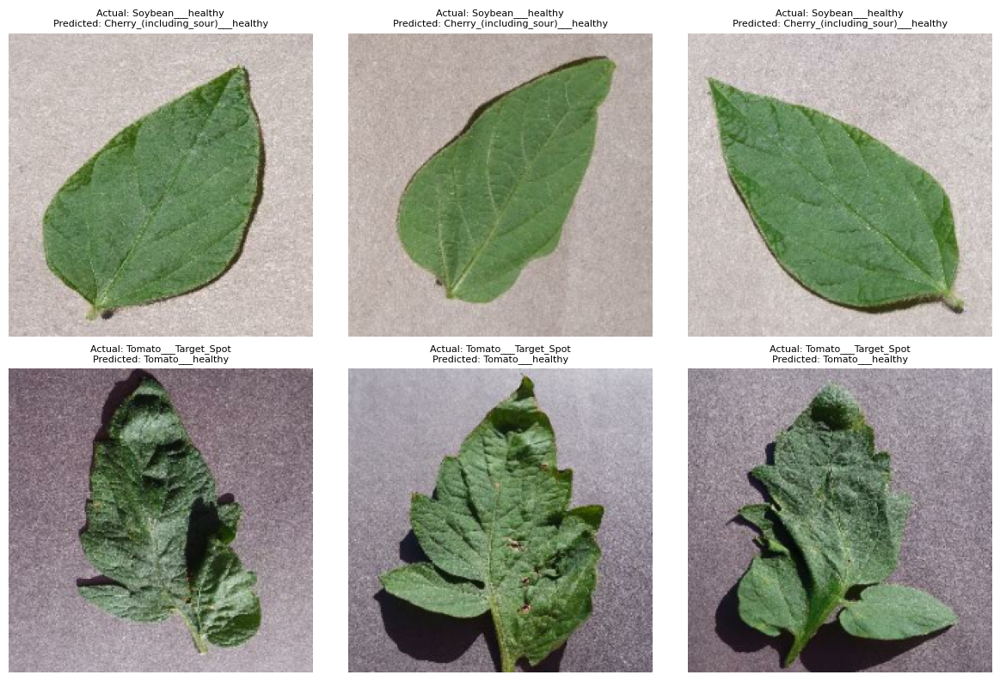
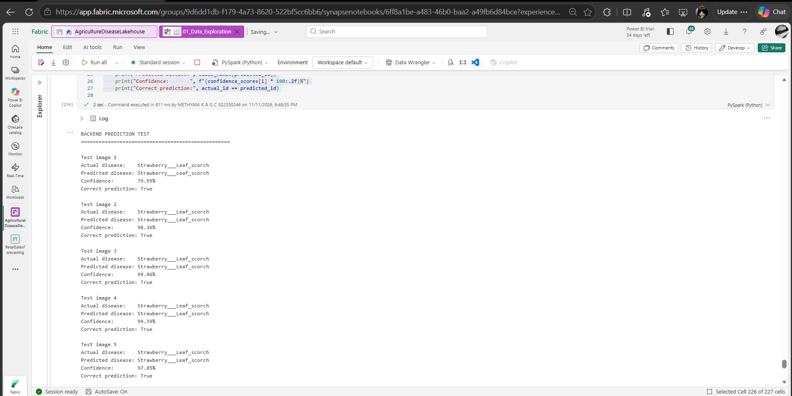
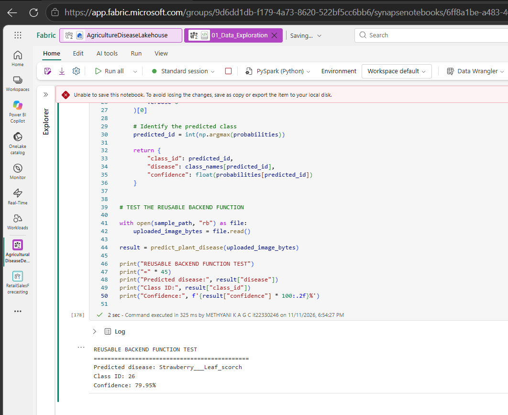

# 🌿 AgriVision AI
### CNN-Based Plant Disease Detection and Classification System

<p align="center">
  An AI-powered plant leaf classification application built using Deep Learning, Microsoft Fabric and Streamlit.
</p>



<p align="center">
  
  
  
  
  
</p>

<p align="center">
  <a href="https://dtcg7czbhbx25vvlg2pppt.streamlit.app/"><b>🌱 Try the Live Application</b></a>
</p>

---

## 📌 1. Project Introduction

AgriVision AI is a deep-learning-based plant disease classification system that identifies plant diseases from uploaded leaf images.

The project uses a Convolutional Neural Network (CNN) developed using TensorFlow and Keras. The model was trained and evaluated in Microsoft Fabric using the PlantVillage colour-image dataset.

The trained model supports 38 plant health and disease categories across 14 crop species.

Users can upload a leaf photograph through the web application and receive a predicted disease category along with the model's confidence score.

The project demonstrates an end-to-end machine learning workflow, from dataset preparation and model development to evaluation, backend inference and cloud deployment.

**Live application:** https://dtcg7czbhbx25vvlg2pppt.streamlit.app/

## 🎯 2. Project Objectives

- Develop a CNN model for multi-class plant disease classification.
- Process RGB leaf images and identify visual disease patterns.
- Train and evaluate the model using Microsoft Fabric.
- Analyse classification performance using multiple evaluation metrics.
- Build a reusable prediction backend.
- Develop an interactive Streamlit application.
- Deploy the application for public access.

## 📊 3. Dataset

**Dataset:** PlantVillage

**Dataset configuration:** Colour (RGB)

**Number of classes:** 38

**Crop species:** 14

The dataset contains labelled images of healthy and diseased plant leaves.

The 38 classes include different conditions affecting apple, blueberry, cherry, corn, grape, orange, peach, pepper, potato, raspberry, soybean, squash, strawberry and tomato plants.

### Dataset sources

- Original dataset repository: https://github.com/spMohanty/PlantVillage-Dataset
- Hugging Face dataset: https://huggingface.co/datasets/mohanty/PlantVillage
- TensorFlow Datasets documentation: https://www.tensorflow.org/datasets/catalog/plant_village
- Dataset distribution on Mendeley Data: https://data.mendeley.com/datasets/tywbtsjrjv/1

The colour-image configuration was selected because RGB information preserves visible colour variations that may be relevant to plant disease classification.

### Dataset preparation

The images were prepared using the following steps:

1. Image loading and label extraction.
2. Resizing images to 224 × 224 pixels.
3. RGB image processing.
4. Pixel normalisation to the range 0–1.
5. Numerical class encoding.
6. Separation into training, validation and test datasets.

The test dataset contained 10,709 images.

The class mapping was preserved in `class_names.json` to ensure that model output indices correspond to the correct disease labels.

## 🏗️ 4. Project Architecture and Workflow

```text
PlantVillage Dataset
        |
        v
Microsoft Fabric Lakehouse
        |
        v
Data Preparation
224 x 224 RGB Images
Pixel Normalisation
Class Encoding
        |
        v
Training / Validation / Test
        |
        v
CNN Model Development
TensorFlow + Keras
        |
        v
Model Training
Early Stopping
Best Checkpoint Selection
        |
        v
Model Evaluation
Accuracy / Precision / Recall
F1-score / Confusion Matrix
        |
        v
Saved CNN Model
.keras Format
        |
        v
Reusable Prediction Backend
        |
        v
Streamlit Web Application
        |
        v
Streamlit Community Cloud
        |
        v
Public Web Application
```

## 🧠 5. Why CNN?

A Convolutional Neural Network is a deep-learning architecture designed for image processing and classification.

CNNs learn image features automatically through convolutional filters.

This is useful for plant disease classification because symptoms may appear through visual differences such as colour changes, spots, patterns and leaf textures.

### Main CNN components

**Convolutional layers**

Extract spatial features from the input image using learnable filters.

**ReLU activation**

Introduces non-linearity, allowing the network to learn more complex patterns.

**Pooling layers**

Reduce the spatial dimensions of feature maps while retaining important information.

**Fully connected layers**

Combine extracted features to support final classification.

**Softmax output layer**

Produces a probability distribution across the 38 output classes.

The class with the highest predicted probability is selected as the model prediction.

## ⚙️ 6. Model Training

The CNN was trained using the training dataset and monitored using the validation dataset.

Early stopping was used to monitor validation loss.

This technique helps prevent unnecessary training when validation performance stops improving.

The best validation-loss checkpoint was selected, and the model weights were restored to the best-performing epoch.

**Best validation loss:** Approximately 0.8351 at epoch 10.

**Early stopping:** Epoch 15.

The selected model was saved in Keras format and reused for backend inference.

## 📈 7. Model Evaluation

The final model was evaluated using 10,709 unseen test images.

### Overall evaluation results

| Metric | Result |
|---|---:|
| Test accuracy | 73.67% |
| Test loss | 0.8770 |
| Macro precision | 76.02% |
| Macro recall | 76.60% |
| Macro F1-score | 72.65% |
| Weighted precision | 82.13% |
| Weighted recall | 73.67% |
| Weighted F1-score | 74.80% |
| Test samples | 10,709 |
| Classes | 38 |

### Understanding the evaluation metrics

**Accuracy:** Measures the proportion of all predictions that are correct.

**Precision:** Measures how many predictions for a particular class are actually correct.

**Recall:** Measures how many actual examples of a class are successfully identified.

**F1-score:** Combines precision and recall using their harmonic mean.

**Macro average:** Gives equal importance to every class.

**Weighted average:** Accounts for the number of samples in each class.

Both macro and weighted metrics were considered because performance can differ across the 38 categories.

### Selected class-level results

| Class | F1-score |
|---|---:|
| Squash Powdery mildew | 94.65% |
| Strawberry Leaf scorch | 92.12% |
| Potato Early blight | 82.41% |
| Pepper Bacterial spot | 77.42% |
| Tomato Bacterial spot | 76.78% |
| Potato healthy | 44.00% |
| Tomato Target Spot | 41.78% |

These results show that model performance varies between disease categories.

### Confusion matrix and error analysis

A confusion matrix and normalised confusion matrix were generated to identify classification errors.

Examples of observed errors included:

- Soybean healthy predicted as Cherry healthy: 347 images.
- Tomato Target Spot predicted as Tomato healthy: 151 images.
- Tomato Spider mites predicted as Tomato healthy: 117 images.
- Pepper healthy predicted as Cherry healthy: 83 images.

These errors indicate that some classes share visual patterns that the model finds difficult to distinguish.

Misclassification analysis provides additional insight into model behaviour beyond overall accuracy.

## 🔬 8. Why These Methods Were Chosen

| Method | Reason |
|---|---|
| PlantVillage | Provides labelled leaf images across multiple crops and conditions |
| RGB images | Retain colour information |
| 224 × 224 resizing | Standardises model input dimensions |
| Normalisation | Provides consistent pixel value ranges |
| CNN | Learns visual features automatically |
| Softmax | Supports 38-class classification |
| Validation dataset | Monitors model generalisation during training |
| Early stopping | Prevents unnecessary training |
| Classification report | Evaluates individual class performance |
| Confusion matrix | Identifies specific classification errors |
| Keras model saving | Enables model reuse without retraining |
| Streamlit | Enables rapid development of an interactive web application |

## 🔄 9. Alternative Approaches

### Traditional machine learning

Algorithms such as SVM and Random Forest could classify images using manually extracted features.

However, feature extraction would need to be designed separately.

CNN was selected because it can learn useful image representations directly.

### Transfer learning

Pretrained models such as MobileNetV2, ResNet and EfficientNet can be adapted for plant disease classification.

They are useful alternatives when leveraging features learned from large image datasets.

### Vision Transformers

Vision Transformers use attention mechanisms to model relationships between image regions.

They offer another approach to image classification but introduce different computational requirements.

### Object detection

YOLO and similar architectures locate and classify objects within an image.

This project focuses on classifying an uploaded leaf image into a disease category, so image classification was selected instead.

## 💻 10. Backend and Prediction Process

The trained CNN model was saved as:

`best_plant_disease_cnn.keras`

The class mapping was saved as:

`class_names.json`

A reusable backend prediction function was implemented to:

1. Accept uploaded image bytes.
2. Decode the image into RGB format.
3. Resize it to 224 × 224 pixels.
4. Normalise pixel values.
5. Add the batch dimension.
6. Run CNN inference.
7. Identify the class with the highest probability.
8. Return the predicted disease and confidence.

The saved model was loaded independently and tested before integration into Streamlit.

## 🌐 11. Web Application

The application was developed using Streamlit.

### Main functionality

- Image upload.
- Uploaded image preview.
- CNN model loading.
- Disease prediction.
- Confidence score display.
- Prediction result presentation.

The application loads the saved model instead of retraining it whenever a user accesses the website.

**Live application:** https://dtcg7czbhbx25vvlg2pppt.streamlit.app/

## 📸 12. Implementation Screenshots

### Microsoft Fabric Lakehouse



### CNN model architecture



### CNN model training



### Classification report





### Misclassification analysis



### Backend prediction test




### Deployed Streamlit application


## 🛠️ 13. Technologies Used

- Python
- TensorFlow
- Keras
- NumPy
- Pandas
- Scikit-learn
- Matplotlib
- Microsoft Fabric
- Streamlit
- Git
- GitHub
- Streamlit Community Cloud

## 📁 14. Project Structure

```text
AgriVision-AI/
│
├── app.py
├── requirements.txt
│
├── models/
│   ├── best_plant_disease_cnn.keras
│   └── class_names.json
│
├── screenshots/
│   ├── 01_lakehouse.png
│   ├── 02_cnn_training.png
│   ├── 03_classification_report.png
│   ├── 04_confusion_matrix.png
│   ├── 05_misclassified_images.png
│   ├── 06_backend_prediction.png
│   └── 07_live_application.png
│
└── README.md
```

## 🚀 15. Running the Application Locally

### Clone the repository

```bash
git clone YOUR_REPOSITORY_URL
cd AgriVision-AI
```

### Create a virtual environment

```bash
python -m venv .venv
```

### Activate the environment on Windows

```powershell
.venv\Scripts\Activate.ps1
```

### Install dependencies

```bash
pip install -r requirements.txt
```

### Start the application

```bash
streamlit run app.py
```

## ⚠️ 16. Limitations

- Test accuracy is 73.67%, so predictions are not always correct.
- Performance differs across disease categories.
- Visually similar diseases may be confused.
- Laboratory-style dataset images may not represent real field conditions.
- Confidence scores should not be interpreted as guarantees of correctness.
- The application should be treated as a decision-support prototype, not a replacement for expert agricultural diagnosis.

## 🔮 17. Future Improvements

- Evaluate transfer-learning architectures.
- Test on independently collected field images.
- Improve generalisation to different backgrounds and lighting.
- Add top-three predictions.
- Introduce Grad-CAM visual explanations.
- Provide disease information from verified agricultural sources.
- Expand the range of supported crops and conditions.

## 📚 18. References and Acknowledgements

### Dataset

Hughes, D. P., & Salathé, M. (2015). *An open access repository of images on plant health to enable the development of mobile disease diagnostics through machine learning and crowdsourcing.*

https://arxiv.org/abs/1511.08060

PlantVillage dataset distribution:

https://huggingface.co/datasets/mohanty/PlantVillage

Original dataset repository:

https://github.com/spMohanty/PlantVillage-Dataset

### Research paper

Mohanty, S. P., Hughes, D. P., & Salathé, M. (2016). Using Deep Learning for Image-Based Plant Disease Detection. *Frontiers in Plant Science, 7*, 1419.

https://doi.org/10.3389/fpls.2016.01419

### Framework documentation

TensorFlow: https://www.tensorflow.org/

Keras: https://keras.io/

Microsoft Fabric: https://learn.microsoft.com/fabric/

Streamlit: https://docs.streamlit.io/

### Acknowledgement

The PlantVillage dataset and its original researchers are acknowledged for providing the image data used in this project. The model development, training, evaluation, backend implementation and web application were carried out as part of this project.

---

## 👩‍💻 Project Summary

**Project name:** AgriVision AI

**Project domain:** Artificial Intelligence, Deep Learning, Computer Vision and Agriculture

**Model:** Convolutional Neural Network

**Number of classes:** 38

**Test accuracy:** 73.67%

**Development environment:** Microsoft Fabric

**Deployment:** Streamlit Community Cloud

**Application:** https://dtcg7czbhbx25vvlg2pppt.streamlit.app/
